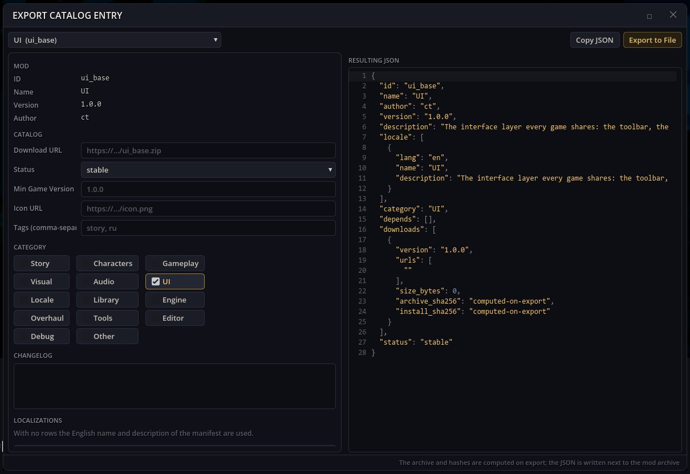

# カタログのエクスポート — MOD を MOD カタログで公開する

MOD カタログは、MOD マネージャーが MOD をダウンロードする元になる JSON の一覧です。カタログのエクスポートは、そうしたカタログ向けに MOD の項目（言語ごとの名前と説明、カテゴリー、タグ、バージョン、変更履歴、ダウンロードリンク）を書き出し、項目が指すアーカイブに MOD をまとめ、アーカイブとインストールされるファイルの SHA-256 チェックサムを付けます。

## 開き方

ゲームのツールバーのハンマーボタン → **カタログ項目を書き出す**。

## MOD の書き出し

1. **MOD を選択**します。フォームはそのマニフェストから埋まります。
2. **ダウンロード URL**（アーカイブを置く場所、必須）、**アイコンの URL**、**カテゴリー**、**タグ（カンマ区切り）**、**最低ゲームバージョン**、**状態**、**変更履歴**を入力します。**言語を追加**で別の言語の名前と説明を加えます。
3. **できあがる JSON** に結果が表示されます。**JSON をコピー**でクリップボードに入ります。
4. **ファイルに書き出す**: フォルダー MOD なら MOD フォルダーに `.zip` アーカイブとその `.json` 項目が書かれます。すでに `.zip` の MOD なら、その横に `.json` だけが書かれます。ステータス行に書き出したパスが出ます。

アーカイブをダウンロードリンクの場所にアップロードし、項目をカタログに加えると、MOD マネージャーがその MOD をインストール候補として表示します。

## 依存関係

`tools_base`、`ui_base`。ゲーム自身のカタログ・アーカイブのコードを使い、MOD マネージャーのウィンドウは不要です。
古い `editor_tools` パッケージは、この MOD をほかの作成用ウィンドウと一緒にインストールします。
