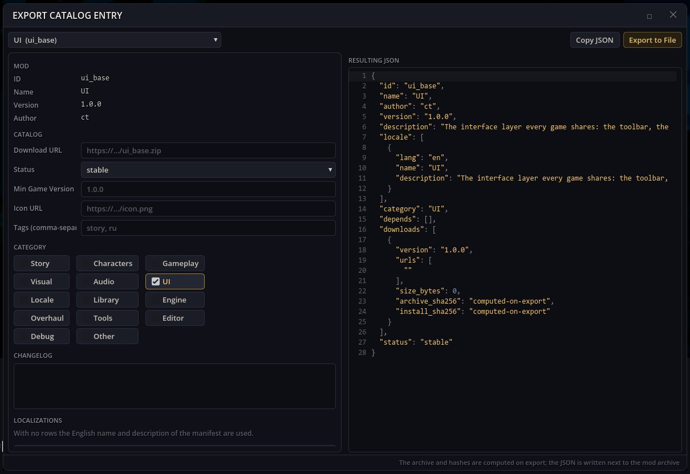

# 카탈로그 내보내기 — 모드를 모드 카탈로그에 공개하기

모드 카탈로그는 모드 관리자가 모드를 내려받는 JSON 목록입니다. 카탈로그 내보내기는 그런 카탈로그용 모드 항목(언어별 이름과 설명, 분류, 태그, 버전, 변경 기록, 다운로드 링크)을 쓰고, 항목이 가리키는 아카이브로 모드를 묶으며 아카이브와 설치 파일의 SHA-256 체크섬을 붙입니다.

## 여는 방법

게임 툴바의 망치 버튼 → **카탈로그 항목 내보내기**.

## 모드 내보내기

1. **모드 선택**. 양식이 모드의 매니페스트로 채워집니다.
2. **다운로드 URL**(아카이브를 올릴 곳, 필수), **아이콘 URL**, **분류**, **태그 (쉼표로 구분)**, **최소 게임 버전**, **상태**, **변경 기록**을 채웁니다. **언어 추가**로 다른 언어의 이름과 설명을 더합니다.
3. **결과 JSON**에 결과가 보입니다. **JSON 복사**는 클립보드에 넣습니다.
4. **파일로 내보내기**: 폴더 모드라면 모드 폴더에 `.zip` 아카이브와 그 `.json` 항목이 쓰이고, 이미 `.zip`인 모드라면 옆에 `.json`만 쓰입니다. 상태 줄에 기록된 경로가 표시됩니다.

아카이브를 다운로드 링크 위치에 올리고 항목을 카탈로그에 추가하면 모드 관리자가 그 모드를 설치 대상으로 보여 줍니다.

## 의존성

`tools_base`, `ui_base`. 게임 자체의 카탈로그·아카이브 코드를 쓰며 모드 관리자 창은 필요 없습니다.
예전 `editor_tools` 패키지는 이 모드를 다른 제작 창과 함께 설치합니다.
