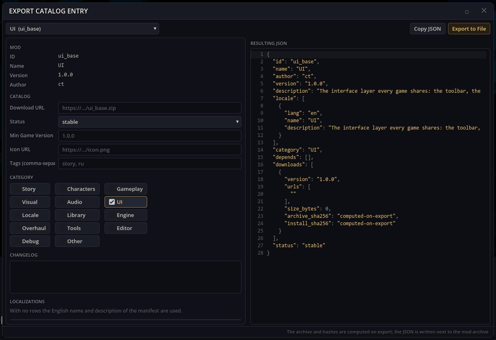

# Экспорт каталога — опубликовать мод в каталоге модов

Каталог модов — это JSON-список, из которого менеджер модов скачивает моды. Экспорт каталога пишет запись мода для такого каталога (названия и описания на разных языках, категория, теги, версии, список изменений, ссылка на скачивание) и упаковывает мод в архив, на который указывает запись, с контрольными суммами SHA-256 архива и установленных файлов.

## Как открыть

Кнопка с молотком на игровом тулбаре → **Экспорт записи каталога**.

## Экспорт мода

1. **Выберите мод**. Форма заполнится из его манифеста.
2. Заполните **URL скачивания** (куда будет загружен архив; обязательно), **URL иконки**, **Категорию**, **Теги (через запятую)**, **Мин. версию игры**, **Статус** и **Список изменений**. **Добавить язык** добавляет название и описание на другом языке.
3. **Итоговый JSON** показывает результат. **Копировать JSON** кладёт его в буфер обмена.
4. **Экспорт в файл**: для мода-папки в папку модов записываются архив `.zip` и его запись `.json`; для мода, который уже является `.zip`, рядом с ним пишется только `.json`. Строка статуса показывает путь записанного файла.

Загрузите архив по ссылке скачивания и добавьте запись в свой каталог — менеджер модов предложит мод к установке.

## Зависимости

`tools_base`, `ui_base`. Используется код каталогов и архивов самой игры; окно менеджера модов не нужно.
Старый пакет `editor_tools` ставит этот мод вместе с остальными авторскими окнами.
