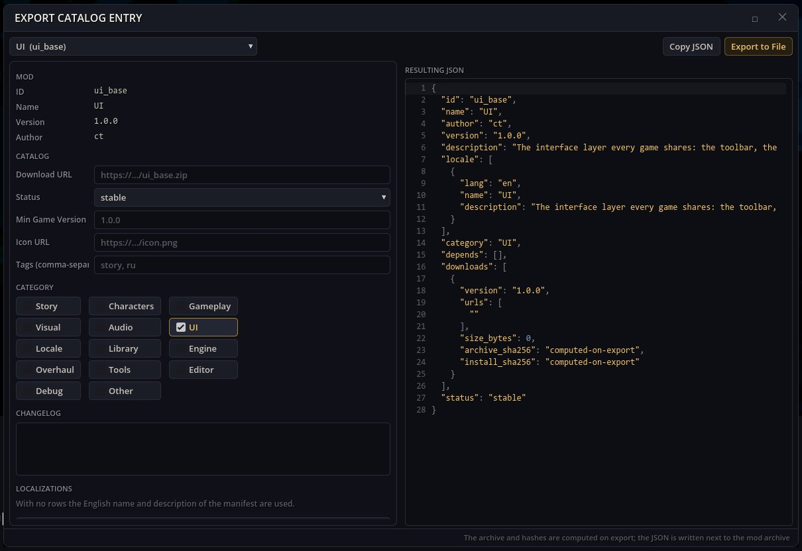

# Xuất danh mục — đăng mod lên một danh mục mod

Danh mục mod là một danh sách JSON mà trình quản lý mod tải mod từ đó. Xuất danh mục ghi mục của một mod cho danh mục như vậy (tên và mô tả theo ngôn ngữ, thể loại, thẻ, phiên bản, nhật ký thay đổi, liên kết tải) và đóng gói mod thành tệp nén mà mục trỏ tới, kèm tổng kiểm SHA-256 của tệp nén và của các tệp được cài.

## Cách mở

Nút búa trên thanh công cụ trong trò chơi → **Xuất mục danh mục**.

## Xuất một mod

1. **Chọn một mod**. Biểu mẫu được điền từ manifest của nó.
2. Điền **URL tải xuống** (nơi sẽ tải tệp nén lên; bắt buộc), **URL biểu tượng**, **Thể loại**, **Thẻ (cách nhau bằng dấu phẩy)**, **Phiên bản game tối thiểu**, **Trạng thái** và **Nhật ký thay đổi**. **Thêm ngôn ngữ** thêm tên và mô tả ở ngôn ngữ khác.
3. **JSON kết quả** hiện kết quả. **Sao chép JSON** đưa nó vào bộ nhớ tạm.
4. **Xuất ra tệp**: với mod dạng thư mục, tệp nén `.zip` và mục `.json` của nó được ghi vào thư mục mod; với mod vốn đã là `.zip`, chỉ ghi `.json` bên cạnh. Dòng trạng thái hiện đường dẫn đã ghi.

Tải tệp nén lên liên kết tải và thêm mục vào danh mục của bạn; trình quản lý mod sẽ đề xuất cài mod đó.

## Phụ thuộc

`tools_base`, `ui_base`. Nó dùng mã danh mục và tệp nén của chính trò chơi, không cần cửa sổ trình quản lý mod.
Gói cũ `editor_tools` cài mod này cùng các cửa sổ tác giả khác.
