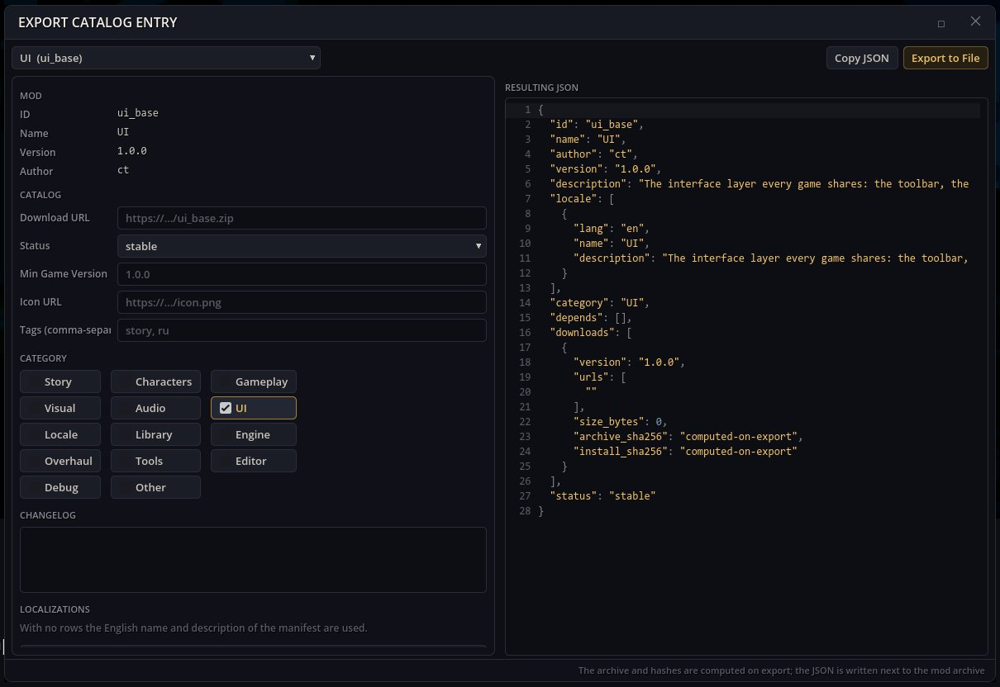

# 目录导出 —— 把模组发布到模组目录

模组目录是一个 JSON 列表，模组管理器从中下载模组。目录导出为这样的目录写出模组条目（各语言的名称和描述、分类、标签、版本、更新日志、下载链接），并把模组打包成条目所指向的压缩包，附带压缩包和安装文件的 SHA-256 校验和。

## 打开方式

游戏工具栏上的锤子按钮 → **导出目录条目**。

## 导出模组

1. **选择模组**。表单会根据它的清单自动填写。
2. 填写**下载 URL**（压缩包将上传的位置，必填）、**图标 URL**、**分类**、**标签（逗号分隔）**、**最低游戏版本**、**状态**和**更新日志**。**添加语言**会加上另一种语言的名称和描述。
3. **生成的 JSON** 显示结果。**复制 JSON** 把它放进剪贴板。
4. **导出到文件**：对于文件夹模组，会在模组文件夹中写出 `.zip` 压缩包及其 `.json` 条目；对于本身已是 `.zip` 的模组，只在它旁边写出 `.json`。状态栏显示写出的路径。

把压缩包上传到下载链接，并把条目加入你的目录；模组管理器就会提供该模组供安装。

## 依赖

`tools_base`、`ui_base`。它使用游戏自身的目录和压缩包代码，不需要模组管理器窗口。
旧的 `editor_tools` 包会把这个模组和其他创作窗口一起安装。
